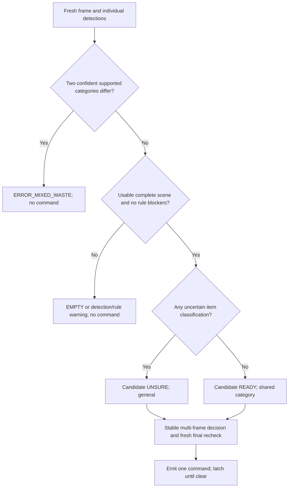

# Multi-object classification architecture and evaluation

Revised **2026-11-09** for single-mechanism, multi-item sorting. This is a research/design proposal, not an implemented or experimentally validated system. No Arduino communication or servo control is included.

## Operating contract

Support one item or a batch of individually resolved items in a fixed, diffusely lit observation tray. **Different object types may share a destination.** Apply Korean disposal rules to every item, then apply confirmed-conflict priority, uncertainty fallback and shared-category selection in that order. A whole-image classifier or dominant-class vote cannot implement this contract.

Start with a validated 1–5-item capacity, separated/nonstacked placement, minimum visible item size and full containment inside the tray. Capacity, spacing, resolution, latency and confidence settings are provisional; actual computer and Logitech camera specifications are unknown. Exceeding the validated envelope blocks authorization, rather than silently ignoring extras.

The site collection contract must accept the selected stream. Two eligible plastic containers, or an eligible plastic container plus a can, can produce `recycling`. **Clear beverage PET bottles remain a separate-stream issue under the existing default profile**: the user's bottle examples are valid only when a reviewed site profile supports their intended collection route. Same engineering destination does not override official preparation or collection requirements. See [Korean rules](01_korean_waste_sorting.md).

## Pipeline



### Capture, detection and completeness

Use OpenCV capture success, timestamps, actual frame dimensions and backend settings; failed/stale capture cannot be EMPTY. Check blur, exposure, motion, hands and tray-edge clipping. Preserve the whole scene for detection and transform boxes back to original-frame coordinates. [OpenCV API](https://docs.opencv.org/4.x/d8/dfe/classcv_1_1VideoCapture.html).

Fine-tune `yolo26n.pt` for the project object ontology, comparing YOLO11n under matched conditions. COCO labels are insufficient. Each instance produces `bbox_xyxy` in original-frame pixels, object class, detection/class score, optional calibrated crop-classification score, official Korean stream, final supported destination or null, preparation evidence and rejection reasons. Detector confidence is not automatically a calibrated disposal probability. See [model comparison](02_model_comparison.md).

Use two validation-selected thresholds: a lower **candidate retention threshold** and a higher **authorization threshold**. Low-score candidates are retained as unresolved evidence, not removed before agreement checking. Tune maximum detections, minimum object size and any suppression settings against small/overlapping objects. Hitting a detection cap or ambiguous duplicate suppression blocks authorization. A closed-set detector may miss an unfamiliar object entirely, so candidate thresholds alone are insufficient.

Compare detections against an independently maintained empty-tray foreground/occupancy estimate. Unexplained occupied regions, count disagreement, uncertain foreground, or a recently lost track produce `WARNING_DETECTION` with no command. Do not update the empty background while occupied. Bounding-box union covering all foreground is **not proof** that every object is accounted for: one large box may hide another item. Masks and a second view may help but remain fallible. Evaluate transparent film, shadows and thin paper specifically. No detections plus any occupied/ambiguous evidence is uncertain; only independently confirmed empty view is EMPTY.

A monocular RGB system cannot guarantee discovery of a fully concealed item. Define the acceptance envelope around exposed separated objects; reject stacks, nesting and observed partial obscuration. If coverage cannot be established, ask the user to spread the items out. An optional second camera/view is a later experiment, not a guarantee or a new hardware requirement.

### Overlap and temporal identity

Bounding-box overlap alone does not establish physical occlusion: irregular objects can have intersecting boxes without hiding each other. Investigate instance masks (`yolo26n-seg.pt`) to distinguish touching boundaries and crop contamination. Masks represent visible regions; they do not establish hidden object count or hidden material. **No authorization while any item is partially obscured or its visibility is unresolved.** [Ultralytics instance segmentation](https://docs.ultralytics.com/tasks/segment/).

Associate instances through time using explicitly configured ByteTrack or a validated geometry-based tracker for the static tray. Ultralytics exposes multi-object tracking and IDs; pin the tracker configuration rather than relying on changing defaults. [Tracking documentation](https://docs.ultralytics.com/modes/track/). ByteTrack associates lower-score boxes to existing trajectories, useful for continuity, but that is not permission to authorize an occluded object. Its published benchmarks are not this waste task. [ByteTrack paper](https://arxiv.org/abs/2110.06864).

A predicted/interpolated track without a fresh observation is unresolved. New tracks, lost tracks, identity ambiguity, replacement, movement or category changes invalidate the whole stability window. A track's expiry must never turn a previously mixed/unknown batch into an apparently homogeneous batch. Establish observed removal or require tray clearance. Counts alone are insufficient: two objects can be replaced by two others without changing count. Track IDs are bookkeeping, not proof of identity; also check scene change and geometry.

### Per-item rules

Keep versioned local rules, source URLs, effective dates, object/material predicates and preparation requirements. Distinguish **classification uncertainty** (unknown identity, low recognition confidence or unresolved inferred material/disposal category) from **explicit rule blockers** (known special collection, known unmet preparation, missing/contradictory site profile). The former may use the requested general fallback; the latter remains `ERROR_UNSUPPORTED` or `ERROR_RULE` with no command. Detection ambiguity is separately `WARNING_DETECTION`, not a fallback classification.

A confidently recognized GENERAL item has a positive Korean rule match. An uncertain item assigned to general retains `official_stream=null` when unresolved, `item_state=uncertain` and `assignment_basis=uncertainty_fallback`; it is not relabeled as confidently nonrecyclable. This fallback is a user-requested operating policy, **not an official Korean disposal rule or a guarantee of correct disposal**. In a recycling-plus-unknown batch the entire batch goes to general, so recognized recyclables may be diverted; record that explicitly. Known batteries, cartons and other excluded streams are not converted to general merely because they are unsupported.

## Decision priorities and proposed logic

The following applies to fresh observations. A stale/failed frame provides no usable classification. Among fresh confident item decisions, a confirmed category conflict always takes priority, including when an unknown item or detection warning also exists. Retain secondary warning reasons in the UI.

| Scene / condition | Status after temporal confirmation | Command |
|---|---|---|
| At least two confident supported categories differ | ERROR_MIXED_WASTE | null |
| No detections and independently verified empty | EMPTY | null |
| No detections but foreground present; count/separation/occlusion unresolved | WARNING_DETECTION | null |
| Known special stream or explicit Korean/site rule blocker, without confirmed conflict | ERROR_UNSUPPORTED / ERROR_RULE | null |
| Usable scene, no confirmed conflict, one or more uncertain classifications | UNSURE | general, once |
| Usable scene, all items confident in the same supported category | READY | Shared paper/recycling/general, once |
| Stability/recheck pending | OBSERVING | null |
| Event already emitted and tray not cleared | LATCHED | null |

Confidence thresholds must be configured and fitted on held-out data, not hard-coded from example percentages. Per-item `category_confident` requires the configured recognition/category thresholds and a resolved applicable rule. Do not insert fallback `general` into the set of **confident** categories: paper plus unknown is UNSURE/general, not mixed waste.

Illustrative policy specification only; no runtime application is implemented:

```python
VALID_COMMANDS = {"paper", "recycling", "general"}

def assess_frame(scene):
    if not scene.fresh_and_valid:
        return "WARNING_DETECTION", None
    confirmed = {
        item.destination for item in scene.instances
        if item.category_confident and item.destination in VALID_COMMANDS
    }
    if len(confirmed) >= 2:
        return "ERROR_MIXED_WASTE", None
    if not scene.instances:
        return ("EMPTY", None) if scene.verified_empty else ("WARNING_DETECTION", None)
    if not scene.complete_and_unobscured:
        return "WARNING_DETECTION", None
    if scene.rule_blocked:
        return "ERROR_RULE", None
    if any(item.known_unsupported for item in scene.instances):
        return "ERROR_UNSUPPORTED", None
    if any(not item.category_confident or item.destination not in VALID_COMMANDS
           for item in scene.instances):
        return "CANDIDATE_UNSURE", "general"
    return "CANDIDATE_READY", next(iter(confirmed))

# Candidates are internal assessments, not outgoing commands.
# Only the temporal/final-recheck gate changes CANDIDATE_UNSURE to UNSURE
# or CANDIDATE_READY to READY and emits one event.
# All other statuses, expired candidates and already-emitted scenes have command=None.
```

### Stability, final recheck and one-command latch

Configure `candidate_detection_threshold`, per-class recognition/category confidence thresholds, `min_stable_frames`, `min_stable_duration_ms`, `max_frame_age_ms`, `max_interframe_gap_ms`, geometry tolerance, authorization expiry and empty-reset duration in a versioned profile. Select these from local validation; do not use the example 42% as a threshold. Preserve low-score region candidates for detection-completeness checks, distinct from low classification confidence on an otherwise well-localized item.

Require consecutive fresh observations of the same complete batch. For READY, confident item destinations and batch destination must stay stable. For UNSURE, the uncertain item IDs, confident category set, fallback decision and absence of conflict/blockers must stay stable; an uncertain item's top label need not be stable. If confidence crosses a threshold, the confirmed set changes, an item moves/enters/leaves, or visibility fails, restart the window. Mixed evidence blocks immediately and cannot be averaged away. Resolve conflicting evidence through a fresh stable window or observed scene change, not a one-frame disappearance. Both READY and UNSURE need the same final recheck and latch.

Immediately before authorizing, obtain a **new** frame after the stability window, rerun full-scene detection and rules, compare presentation revision/track set, and verify no pending veto. Bind the authorization to `presentation_id`, `scene_revision`, timestamp, model/rule versions and a unique `event_id`. Use a short validated expiry so queued results cannot authorize a changed scene. Never send a command per item.

Latch after a single event until sustained verified emptiness (configured empty-reset duration). Removal of one item or insertion of another after emission does not re-arm; ask for full clearance. Before emission, an observed change cancels the candidate and starts a new stability window only after all objects are freshly accounted for. Camera interruption disarms and requires verified clearance; tracker reset is not clearance. A retry button cannot bypass the latch, stability or detection checks.

A future actuator adapter must revalidate event freshness/presentation and accept only the three command strings, never raw status text. No such adapter is implemented here. Camera rechecking has latency and cannot guarantee that nothing changes after the frame; future unattended hardware needs access interlocking or equivalent controlled presentation.

## UI and event schema

Show original-frame boxes, stable track IDs, object labels, separately labeled confidence scores, official Korean streams, supported destination or rejection reason, detected count and completeness status. Use dashed/amber regions for unresolved foreground. “Detected: 2; scene unresolved” must not suggest exactly two physical items are known to exist. Errors take visual priority over a stale READY overlay.

Illustrative per-item record:

```json
{
  "track_id": 7,
  "bbox_xyxy": [80, 100, 240, 420],
  "object_class": "plastic_container",
  "detection_score": 0.96,
  "classification_confidence": 0.94,
  "official_stream": "플라스틱류",
  "destination": "recycling",
  "item_state": "supported",
  "preparation_evidence": "operator_verified",
  "rule_id": "example-site-plastic-v1",
  "occlusion_state": "none_observed"
}
```

Display an individual recognition/classification score for every detected object, including uncertain ones; identify its source (detector class score or calibrated crop classifier). If unavailable, show “unavailable” and treat classification as uncertain, never fabricate a percentage. Localization confidence is separately labeled. The numeric scores are illustrative, not measured. Batch event fields: `presentation_id`, `scene_revision`, `event_id`, `observed_at`, `expires_at`, `items`, `status`, `destination`, `command`, `reason_codes`, `uncertain_item_ids`, `assignment_basis`, `warning`, `confidence_profile_version`, `model_version`, `rules_version`. Every error has `destination=null` and `command=null`; per-item hypotheses remain available for explanation.

```text
Detected objects: 3 — scene resolved
1. Plastic container → recycling
2. Aluminum can      → recycling
3. Cardboard         → paper
STATUS: ERROR_MIXED_WASTE
Please separate the waste before sorting.
COMMAND: none
```

```text
Detected objects: 2 — scene resolved and stable
1. Plastic container → recycling
2. Aluminum can      → recycling
STATUS: READY
SORTING CATEGORY: recycling
One batch decision event; no repeat while occupied.
```

```text
Detected object: Unknown packaging
Classification confidence: 42% (illustrative)
STATUS: UNSURE
SORTING CATEGORY: general
Warning: Classification uncertain for object #7. Defaulting to general waste.
COMMAND: general
```

For a confident tissue classification, display `STATUS: READY`, `SORTING CATEGORY: general`, and `assignment_basis: korean_rule`. For fallback, display `assignment_basis: uncertainty_fallback` and the uncertain IDs/reasons. UNSURE is a status, never a fourth category or serial command. The preview may retain the last UNSURE/READY outcome after emission, but the current event channel is latched and emits nothing again.

## Confidence calibration

Calibrate detector correctness (class plus localization) and any separate crop classifier on held-out local scenes; report them separately. Temperature scaling is an option for classifier logits, not an automatic solution to detector/object-count uncertainty. [Calibration research](https://proceedings.mlr.press/v70/guo17a.html). Tune candidate/authorization thresholds using complete-batch risk/coverage and unknown false acceptance, stratified by item count. [Selective classification](https://arxiv.org/abs/1705.08500).

A minimum per-item confidence is a useful gate, not a batch probability. Do not multiply scores and claim independent correctness: detection errors and frames are correlated, and missed items have no score. Use held-out batch outcomes to choose the operational threshold. [Unknown-detection baseline](https://arxiv.org/abs/1610.02136).

## Independent evaluation protocol

### Ground truth and split

Choose a site/jurisdiction and a supported item whitelist first. Two annotators inspect each physical object and its actual preparation, consult the rule source, and adjudicate disagreements. Unresolved labels remain manual review. Keep both object truth and disposal truth.

Recommended split of local **physical objects**: 60% training, 20% validation/calibration, 20% locked test. Divide validation objects into tuning and calibration subsets if size allows; otherwise use group cross-validation within the development pool and reserve a final calibration set. All frames, product derivatives, clean/dirty states and augmentation of one object stay together. Hold out some entire product families and a later collection session to test novelty. Never tune thresholds on the final test. Public duplicates and near duplicates must be resolved before splitting.

For the 360–800-object collection plan, the locked test initially contains roughly 72–160 known objects. This supports exploratory comparison, not a precise claim of sub-1% sorting errors. Expand testing with fresh objects after model/rule freeze. Add at least 100–200 diverse unknown/unsupported presentations, including near-known packaging, empty trays, hands, two touching objects, labels facing away, wet items and transparent/glare cases. Keep separate unknown families for validation and final test. Use safe substitutes for hazardous challenge objects.

### Metrics and denominators

| Metric | Required definition / reporting |
|---|---|
| Object accuracy | Correct object labels / matched ground-truth instances; report misses separately and end-to-end instance recall; also report per-image accuracy separately |
| Precision, recall, macro-F1 | Object classes and final destination classes separately; show support counts and zero-support classes |
| Confusion matrices | Raw and row-normalized; include rejected/unsupported outcomes in decision matrix |
| Per-class false sorting | Incorrect accepted destinations by true stream, especially GENERAL into recyclables and special waste accepted anywhere |
| Selective risk | Wrong accepted destinations / all accepted decisions |
| Coverage | Accepted eligible presentations / all eligible presentations; separately report acceptance over all presented objects |
| Overall wrong-sort rate | Wrong accepted destinations / all presentations, alongside coverage so rejecting everything cannot look successful |
| Unknown performance | Unknown fallback rate and actual disposal correctness; unsupported acceptance; known false rejection; confidence discrimination with declared positive class |
| Calibration | Reliability plot, ECE with bin specification, Brier and NLL on independent known examples; do not hide overconfidence behind ECE alone |
| Condition robustness | Each metric under lighting, blur, orientation, contamination and unseen-product strata |
| Runtime | Batch-1 model median/p95, capture-to-event median/p95, dropped/stale frames, cold start, peak RAM; named hardware/backend |
| Event integrity | Repeated events per presentation, empty-frame events, failed re-arm, mixed-batch false authorizations and timeout/manual-review rate |

Report both classifier errors and rule/preparation errors. An object may be correctly recognized and still routed incorrectly. Replay identical captured sequences for model comparisons, then run a fresh live-camera trial to expose capture/focus/buffering failures. Measure on the actual deployment computer, with fixed thread counts and export settings; cold and warmed runtimes differ.

Use confidence intervals based on independent objects/presentations; repeated views are clustered, not extra independent successes. Bootstrap by physical object where appropriate. For a fixed policy with zero observed independent errors, a rough 95% upper bound is `3/n`: 300 accepted independent objects imply about 1%, while 60 imply about 5%. This is a statistical planning approximation, not a certification. Reusing the same object 300 times does not support that claim.

### Proposed release gates — to agree before testing

For a **supervised classroom classification demo**, target accepted-decision error ≤2% with coverage ≥70% on the supported whitelist, macro-F1 ≥0.90 for object recognition, and p95 capture-to-decision ≤1.5 seconds. Require zero observed special-item, empty-scene, mixed-category and unresolved-occlusion accepted commands and zero repeated events in the defined challenge suite. Publish uncertainty intervals and per-class counts even if these targets are met. These are proposed engineering goals, not literature-derived guarantees; failure means narrow the whitelist or improve data and retest with a new locked set.

Any future unattended actuator deployment needs its own hazard analysis and broader evidence; passing this research prototype protocol does not establish that deployment is safe. The current deliverable is classification research only.


## Multi-object evaluation extension

The evaluation unit for authorization is the **entire presentation/batch**, not a box or frame. A command is wrong if any ground-truth item is missed, unsupported, routed incorrectly, or violates required visibility/scene conditions. A batch can contain correct object predictions yet still be unauthorized. Keep the earlier metric definitions but compute selective risk and coverage at batch level; report homogeneous eligible coverage separately from total-scene acceptance.

| Test family | Required outcome after stable assessment |
|---|---|
| One eligible object in each destination | Shared command once |
| Three prepared cardboard pieces | paper once |
| Two supported plastic containers; plastic container + can | recycling once, despite different object labels |
| Several positively identified general-waste items | general once |
| Paper + recycling; paper + general; recycling + general; all three | ERROR_MIXED_WASTE; no command |
| Known item + resolved-location unknown classification | UNSURE; general once |
| Known item + battery/carton under default profile | ERROR_UNSUPPORTED; no command |
| Paper + recycling + unknown | ERROR_MIXED_WASTE; no command; list unknown as secondary warning |
| Confident bottle plus unexplained foreground with unresolved count | WARNING_DETECTION; no command |
| Zero detections but nonempty/ambiguous tray | WARNING_DETECTION, never EMPTY |
| Stacked, nested, clipped or partially obscured item | WARNING_DETECTION; ask to spread items |
| Touching but fully visible items | Accept only if instance boundaries/completeness are resolved; otherwise uncertain |
| New item enters during stability or final recheck | Cancel candidate immediately; re-evaluate whole batch |
| A mixed/unknown item temporarily disappears behind another | Block; track timeout must not authorize remaining items |
| Same-count object replacement / ID swap | Invalidate old batch evidence |
| Unchanged accepted batch across many frames | Exactly one event |
| Partial removal after event; camera disconnect/reconnect | No re-arm without verified complete clearance |

Measure box mAP50–95, class-wise recall at the operating threshold, count accuracy, duplicate/missed detections, **all-visible-instances-recalled scene rate**, and localization/class errors separately. For masks add mask AP and boundary/instance separation failures. Report mixed-waste recall, mixed-batch false authorization, UNSURE fallback correctness and unsupported-batch false authorization, homogeneous false rejection and risk/coverage by count (1/2/3/4–5), size, lighting and overlap. Tracking diagnostics include identity switches, lost-track events and unsafe recovery; good tracking metrics alone do not satisfy sorting requirements.

Use disjoint physical-object pools to construct train/validation/test scenes as described in [datasets](03_datasets.md). Add at least 30 independent presentations per mixed destination pair and 30 three-way mixtures, plus 30 per homogeneous destination with differing object types where available. These are initial coverage targets, not statistical guarantees; cluster uncertainty estimates by reused object/session and expand after freeze. Include videos with changes immediately before/after readiness. Annotate hidden objects in staged challenges for ground-truth rejection checks even if inference cannot see them.

Revise the classroom gate: require zero observed commands for confirmed mixed, known unsupported, empty or unresolved-occlusion presentations, and zero duplicate events; publish confidence bounds and the number of independent challenge batches. Retain the proposed ≤2% accepted-batch error and ≥70% eligible homogeneous coverage goals, but report by item count so single-item success cannot conceal multi-item failure. Any unsafe acceptance in the defined challenge suite fails the gate. No current model has passed these tests.

## Revised policy acceptance cases and metrics

| Detected items (usable scene; supported site mapping) | Final status | Event command |
|---|---|---|
| Plastic bottle | READY | recycling |
| Two cardboard pieces | READY | paper |
| Plastic bottle + aluminum can | READY | recycling |
| Cardboard + plastic bottle | ERROR_MIXED_WASTE | null |
| Unknown object | UNSURE | general |
| Plastic bottle + unknown object | UNSURE | general |
| Cardboard + plastic bottle + unknown object | ERROR_MIXED_WASTE | null |
| Confident general item + unknown | UNSURE | general |
| Confident general item only | READY | general |
| Cardboard + unknown | UNSURE | general |

These examples assume detection completeness and valid site rules; bottle subtype restrictions remain in force. Test threshold crossings, uncertain ID changes, mixed evidence during an UNSURE window, fresh final recheck, empty input and repeat suppression for **both** successful statuses.

Report policy-conformance separately from actual Korean disposal accuracy. An UNSURE/general event can obey policy yet be an incorrect disposal decision. Preserve independently adjudicated truth; never score fallback as correct merely because it emitted general. Report READY accuracy, UNSURE frequency, fallback correctness, recyclable diversion into GENERAL, known special-stream violations and overall accepted-batch error including fallback. The previous error/coverage targets remain hypotheses and may be harder to meet under this policy; do not hide fallback events by excluding them from the denominator. This change is user-directed, not a research finding that general is always a correct or safe destination for unknown objects.
