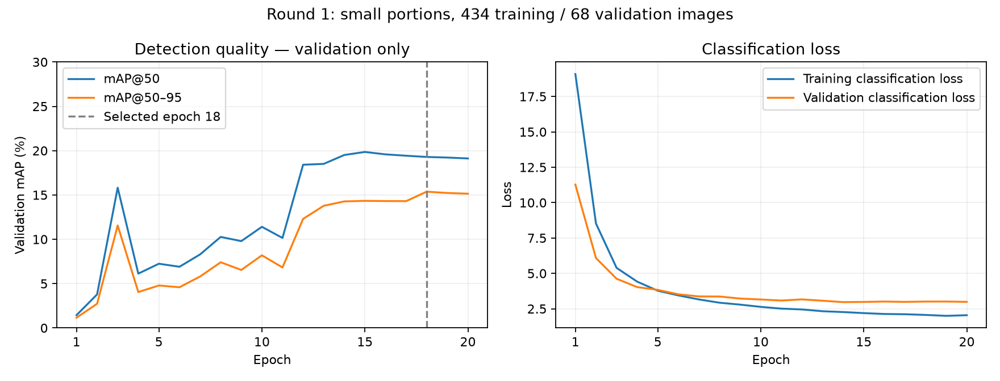

# Training round 1 — lecture analysis

**Closed on 13 November 2026.** Training completed on 12 November. This package freezes the first small-portion experiment for discussion; no additional epochs were run during closeout. The result is an experimental detector, **not a validated automatic sorting system**.

## What we tested

Can a small YOLO26n detector learn waste-object recognition from public images containing only small portions? We used 434 training images, 68 validation images, ten recognition classes and 20 epochs at 416 px on the MacBook's Apple MPS backend. Every retained scene has one to three annotated objects; images with greater count or strong box overlap were excluded. Augmentations that combine scenes were disabled.

The model selected by validation mAP@50–95 is **epoch 18**. Its local file is `weights/small_portions_yolo26n.pt`; [freeze_manifest.json](freeze_manifest.json) records its SHA-256 and dataset identifiers. Model binaries and source images are not on GitHub. Teammates need the local checkpoint from the training-machine owner or must reproduce the run using the [handoff instructions](../../DEVELOPMENT_STATUS.md).

## Main findings

| Selected-checkpoint validation metric | Value | Interpretation |
|---|---:|---|
| mAP@50 | 19.29% | Detection quality across confidence thresholds with IoU ≥ 0.5 |
| mAP@50–95 | 15.37% | Stricter average over several box-overlap requirements; selection criterion |
| Macro precision | 68.06% | Evaluator-selected operating point; not sorting accuracy |
| Macro recall | 15.82% | Low class-averaged object recovery; many objects are missed |

Precision/recall use the evaluator's operating point, not the app's 0.8 threshold. They are class averages, not overall item counts; do not infer that exactly 84.18% of all objects were missed. High reported precision can coexist with zero recall for a class with no useful predictions. The metrics do not measure preparation condition, Korean disposal correctness, unknown rejection or mixed-batch safety.

Training and validation loss fall, and validation detection quality rises overall. Validation gains flatten toward the end while training loss continues to decline. This suggests inspecting data and class coverage before assuming more epochs alone will solve the problem; the curves do not establish a unique cause or prove overfitting. The small validation set also makes the early fluctuations hard to interpret.

## Where the model struggles

Values below are rounded from the final best-checkpoint validation log; the raw extracted table is in [per_class_validation.json](per_class_validation.json).

| Class | Validation objects | Recall | mAP@50 | Discussion |
|---|---:|---:|---:|---|
| Plastic bottle | 5 | 0% | 4.76% | No useful recovery at the selected operating point |
| Glass bottle | 3 | 0% | 0% | Detection failed on this tiny sample |
| Metal can | 1 | 100% | 99.5% | One object cannot establish reliable can recognition |
| Cardboard | 10 | 10% | 17.7% | Most items missed |
| Paper | 1 | 0% | 3.98% | Insufficient coverage and a miss |
| Film/wrapper | 32 | 18.8% | 32.4% | Better represented, but recall still low |
| Plastic container | 1 | 0% | 0% | Insufficient coverage and a miss |
| Cigarette | 7 | 0% | 0.537% | Poor recovery; tiny objects warrant inspection |
| Needs review | 43 | 13.6% | 14.7% | Broad heterogeneous class; not a proven unknown detector |
| Cup | 0 | Not measured | Not measured | Cannot assess this class |

A small portion does not necessarily mean an easy image: the inspected examples still contain outdoor clutter, distant objects and variable lighting. The 1–3 count is based on source annotations and can miss unannotated items. No C920 validation images, empty-tray negatives or hand-only negatives were added.

## What this round does and does not demonstrate

The acquisition, annotation conversion, small-portion selection, training and checkpoint selection pipeline works. Checks preserved source partitions and all annotated instances in the selected images; exact image duplicates were removed before selection. Six policy/temporal unit tests pass, but those tests do not establish detector accuracy.

This does **not** prove reliable enumeration, complete-scene detection, mixed-waste blocking under missed detections, or safe automatic sorting. The earlier 60-class baseline scored 4.21% mAP@50 on its public test set, but that is a different task and split: it is not a fair numerical comparison with the ten-class validation result here. The old public test was not evaluated again for this experiment, and validation was used for selection, so this round has no new independent final-test estimate.

## Decisions to make in the lecture

1. Agree on the actual supported object whitelist and the provisional one-to-three-item presentation limit. Decide how to handle caps, attached components and unclear objects consistently.
2. Inspect several local training/validation images and their predictions. Prioritize missed bottles, cardboard and paper; distinguish tiny/occluded objects from wrong labels or class confusion. Local visual artifacts remain under `runs/waste_training/small_portions/`; they are not included in this public package.
3. Assign collection and annotation of C920 scenes with a fixed tray and lighting. Include single items, same-category pairs, mixed-category pairs, unknown objects, empty scenes, hands and overlaps. Separate physical objects/sessions before creating train, validation and untouched test pools.
4. Increase coverage for scarce classes before a second controlled experiment. Set evaluation acceptance criteria with the team before looking at the new test set; do not tune repeatedly against the previously viewed public test.
5. Keep the demo supervised and leave hardware control absent. The Korean site/preparation rules still need review before enabling confident disposal mappings.

## Frozen evidence

- [Epoch metrics](epoch_metrics.csv): all 20 training epochs.
- [Training configuration](training_config.json): saved arguments with machine-local paths normalized for the repository.
- [Per-class validation](per_class_validation.json): final log values, including explicit absent-class information.
- [Freeze manifest](freeze_manifest.json): model hash, source annotation hash and dataset-manifest hash.
- [Detailed experiment description](../09_small_portions_training.md): class grouping, sample selection and limitations.

This report closes round 1. A changed dataset, taxonomy, threshold policy or new training run belongs to a separately documented round 2. The experimental model is not activated as the live default.
